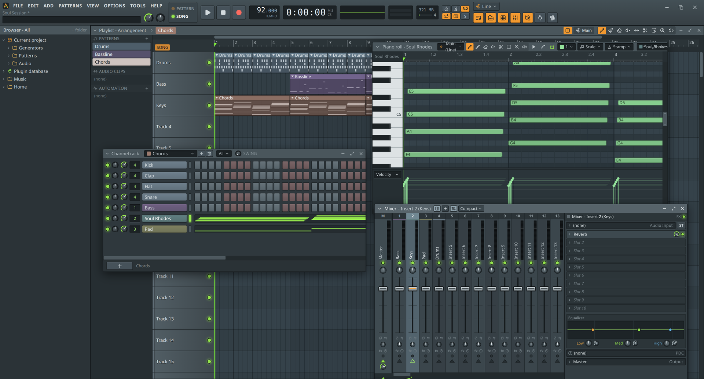

# ArkaneDAW

A Linux-first, pattern-based DAW with an FL Studio-style workflow: channel rack, piano roll, playlist and mixer,
plus its own family of instruments and effects, VST3 / VST2 / CLAP hosting, and audio and MIDI recording.



## Download

Get the latest **AppImage** (Linux) or **Windows installer** from the
[releases page](https://github.com/elevchyt/ArkaneDAW/releases). The app checks for updates on startup.
MP3/OGG/FLAC export needs `ffmpeg`; the app tells you how to install anything that's missing.

## Instruments

| Plugin | What it is |
|---|---|
| **Piano** | Modelled pianos: grands, uprights, felt, honky-tonk, electric pianos (incl. Soul Rhodes), lo-fi and ambient patches, with sustain pedal. |
| **Mosaic** | Flagship layered workstation (Montage homage): piano, EPs, organ with rotary, FM, strings, brass, choir, mallets, synths — up to 4 parts per preset. |
| **Polygon** | 90s Japanese digital ROMpler homage (JV / M1 / SC-55 era): glassy pads, PS1-style pianos, slap bass, choirs, orchestra hits. |
| **Hexa** | DX7-style 6-operator FM synth with all 32 algorithms; loads and exports DX7 `.syx` cartridges. |
| **Atmos** | Atmospheric synth: wavetable, granular and air layers, shimmer reverb, freeze — pads, drones, textures. |
| **Bassline** | Every kind of bass: 303 acid with slide/accent, Moog-style, 808/sub, reese, wobble, FM, and modelled finger/slap/fretless/upright. |
| **Chiptune** | 8-bit synth (Magical 8bit Plug homage): NES/Game Boy channels, Famitracker-style sequences, arpeggiator. |
| **Triple Osc** | Simple three-oscillator starter synth. |
| **Sampler** | Plays any audio file across the keyboard (drop files on the channel rack). |
| **Classic Drum Machines** | Synthesized vintage kits: 808, 909, 606, CR-78, Linn, DMX, 707, SP-12, Simmons and more. |
| **Studio Drums** | Sampled acoustic kits (rock, metal, jazz brushes, funk, latin) with a 21-genre groove library. *Downloadable sound library.* |
| **Chiptune Drums** | NES, Game Boy and Arcade drum kits plus game sound effects. |
| **Concerto** | Baroque/classical instruments: strings with articulations, harpsichord, organ, choir, woodwinds, brass, harp. *Downloadable sound library.* |

## Effects

| Plugin | What it is |
|---|---|
| **Parametric EQ** | 7-band EQ with a draggable response curve and live spectrum. |
| **Compressor / Multiband Compressor** | Dynamics with gain-reduction meters and side-chain. |
| **Limiter** | Look-ahead brickwall limiter for the master. |
| **Gate / Transient** | Noise gate; attack/sustain shaper. |
| **Reverb / Delay** | Room, hall and plate reverb; tempo-synced stereo / ping-pong delay. |
| **Chorus / Phaser / Flanger / Tremolo** | Classic modulation effects. |
| **Distortion / Saturation** | Drive from subtle tape/tube warmth to fuzz and foldback. |
| **Filter / Bitcrusher / Stereo** | Resonant filter with LFO, lo-fi crusher, width / mono-bass / phase utility. |
| **VocalTune** | Simple pitch correction: pick a key and scale, set the retune speed. |
| **Kabee** | Guitar and bass amp with a pedalboard ([elevchyt/kabee](https://github.com/elevchyt/kabee), compiled to WebAssembly). |

## Development

```bash
npm install
npm run dev            # Electron app
npm run build:native   # VST/CLAP host (Linux)
npm test
```

Architecture and conventions: [docs/SPEC.md](docs/SPEC.md). Releasing: [docs/RELEASING.md](docs/RELEASING.md).
Sample library credits: `resources/drumkits/LICENSES.md`, `resources/concerto/LICENSES.md`.
